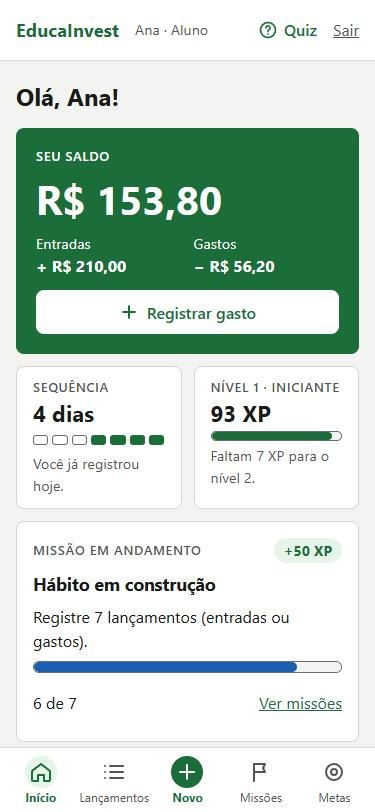
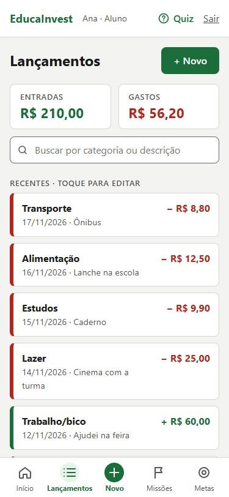
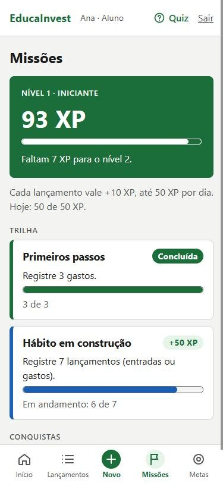
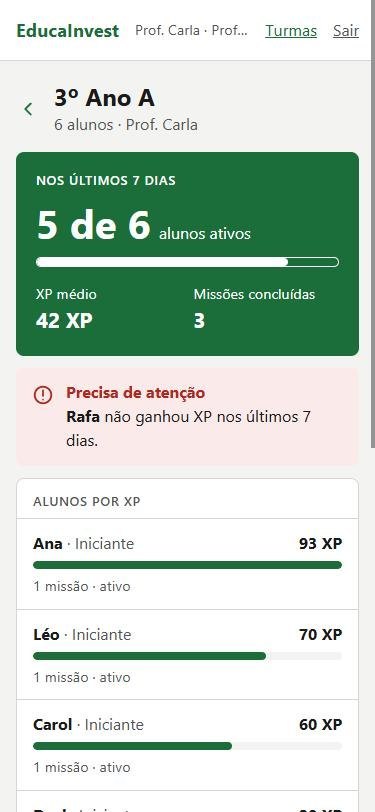

<div align="center">

<a href="https://github.com/LyanKaleu/EducaInvest/actions/workflows/gate.yml"></a>


<br><br>


**Educação financeira na prática para jovens de 16 a 24 anos.**
O aluno registra o próprio dinheiro, cumpre missões e ganha XP. O professor acompanha a turma sem ver valores.

[Especificação](docs/ESPECIFICACAO.md) · [Telas](#telas) · [Rodar localmente](#rodar-localmente) · [Reportar problema](https://github.com/LyanKaleu/EducaInvest/issues)

</div>

## Por que existe

- **Aprender fazendo.** O jovem até sabe o que é orçamento, mas não pratica. Aqui cada gasto registrado vira progresso.
- **O professor acompanha sem invadir.** Ele vê XP, missões e frequência da turma, nunca valores em reais nem e-mail.
- **Leve e confiável no celular.** Sem JavaScript, e um reenvio depois de a conexão cair não duplica nada.

## Funcionalidades

**Aluno**
- **Lançamentos:** entradas e gastos com categoria, busca e saldo na hora.
- **Missões e XP:** trilha de missões, níveis, conquistas e sequência de dias, com teto diário de XP.
- **Metas:** valor-alvo, aportes e barra de progresso.
- **Quiz:** perguntas sobre juros, crédito, orçamento e inflação, sempre com explicação.

**Professor**
- **Turmas:** cada turma tem um código de 8 caracteres para os alunos entrarem.
- **Painel da turma:** XP médio, missões concluídas, alunos ativos em 7 dias e uma linha por aluno.

## Telas

<table>
  <tr>
    <th align="center">Início</th>
    <th align="center">Lançamentos</th>
    <th align="center">Metas</th>
  </tr>
  <tr>
    <td></td>
    <td></td>
    <td></td>
  </tr>
  <tr>
    <th align="center">Missões</th>
    <th align="center">Quiz</th>
    <th align="center">Painel do professor</th>
  </tr>
  <tr>
    <td></td>
    <td></td>
    <td></td>
  </tr>
</table>

Os dados das telas são fictícios.

## Rodar localmente

Precisa do [uv](https://docs.astral.sh/uv/getting-started/installation/), que instala o Python 3.14 e as versões exatas do `uv.lock`. O banco SQLite é criado sozinho no primeiro acesso.

```bash
git clone https://github.com/LyanKaleu/EducaInvest.git && cd EducaInvest
uv sync          # cria o .venv com o Python e as dependências do uv.lock
uv run run.py    # http://127.0.0.1:5000
```

O `run.py` liga o modo debug: use só na sua máquina e nunca com `host="0.0.0.0"`, porque o depurador deixa executar código no servidor.

Em produção, sirva `create_app()` por um servidor WSGI, com a variável `SECRET_KEY` definida e HTTPS (fora do debug, o cookie de sessão só viaja por HTTPS). O banco fica em `instance/educainvest.db`, que precisa estar num disco que não se apaga ao reiniciar.

## Testes

```bash
bash gate.sh   # lint, contratos de arquitetura e testes (o uv sync já instala as ferramentas)
```

## Próximos passos

- Quiz do dia com perguntas de cálculo que mudam a cada dia.
- Gerador de perguntas com IA, com revisão antes de publicar.
- Desfazer aporte em meta.
- Renomear e excluir turma.
