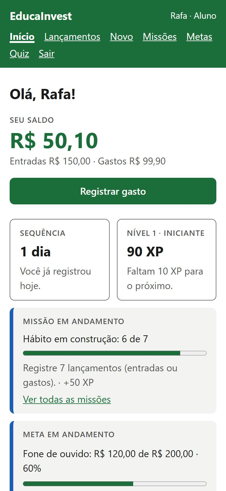
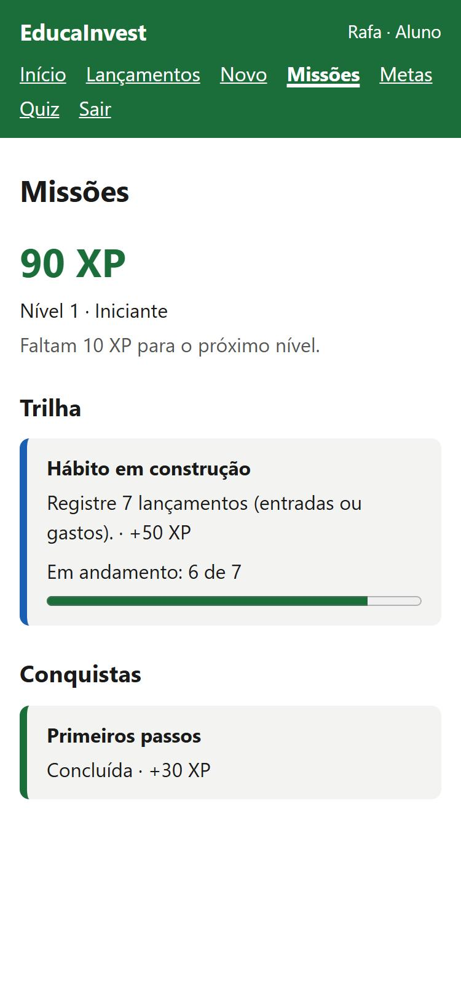
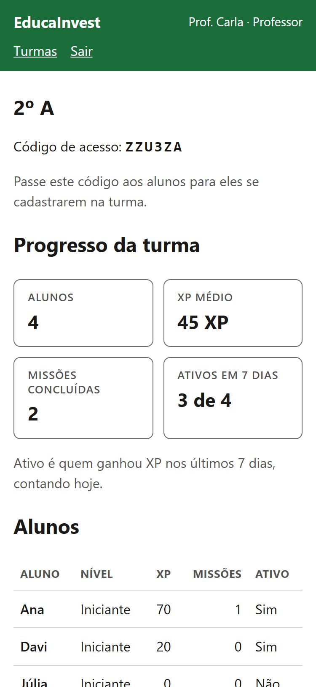

<div align="center">

# EducaInvest

**Educação financeira na prática para jovens de 16 a 24 anos.**
O aluno registra o próprio dinheiro, cumpre missões e ganha XP. O professor acompanha a turma sem ver valores.

<a href="https://github.com/LyanKaleu/EducaInvest/actions/workflows/gate.yml"></a>


[Especificação](docs/ESPECIFICACAO.md) · [Reportar problema](https://github.com/LyanKaleu/EducaInvest/issues)

<br>





</div>

## Por que existe

- **Aprender fazendo.** O jovem até sabe o que é orçamento, mas não pratica. Aqui cada gasto registrado vira progresso.
- **O professor acompanha sem invadir.** Ele vê XP, missões e frequência da turma, nunca valores em reais nem e-mail.
- **Leve e confiável no celular.** Sem JavaScript, e um reenvio depois de a conexão cair não duplica nada.

## Funcionalidades

**Aluno**
- **Lançamentos:** entradas e gastos com categoria, busca e saldo na hora.
- **Missões e XP:** trilha de missões, níveis, conquistas e sequência de dias, com teto diário de XP.
- **Metas:** valor-alvo, aportes e barra de progresso.
- **Quiz:** perguntas sobre juros, crédito, orçamento e inflação, sempre com explicação.

**Professor**
- **Turmas:** cada turma tem um código de 6 caracteres para os alunos entrarem.
- **Painel da turma:** XP médio, missões concluídas, alunos ativos em 7 dias e uma linha por aluno.

## Rodar localmente

Precisa de Python 3.14. O banco SQLite é criado sozinho no primeiro acesso.

```bash
git clone https://github.com/LyanKaleu/EducaInvest.git && cd EducaInvest
python -m venv .venv && source .venv/bin/activate   # Windows: .venv\Scripts\activate
python -m pip install -r requirements.txt
python run.py                                        # http://127.0.0.1:5000
```

Em produção, use `gunicorn "app:create_app()"` com a variável `SECRET_KEY` definida.

## Testes

```bash
python -m pip install -r requirements-dev.txt
bash gate.sh   # lint, contratos de arquitetura e testes
```

## Próximos passos

- Quiz do dia com perguntas de cálculo que mudam a cada dia.
- Gerador de perguntas com IA, com revisão antes de publicar.
- Desfazer aporte em meta.
- Renomear e excluir turma.
